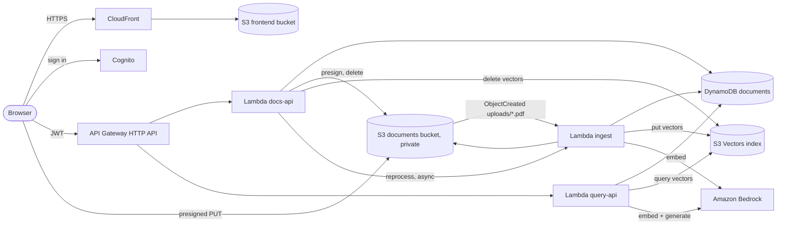
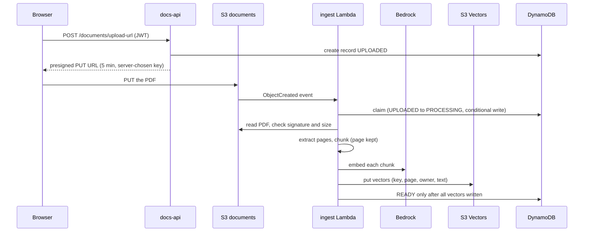
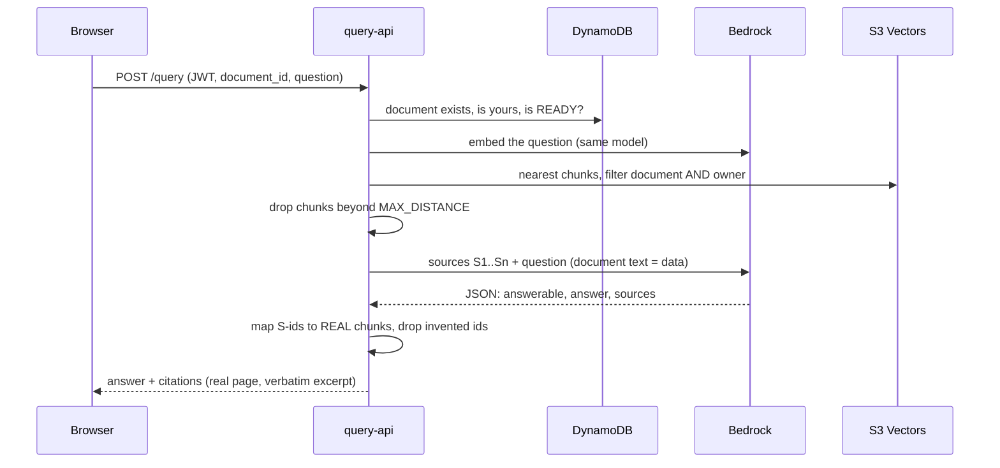

# Document Q&A Assistant

Upload a PDF, ask questions in plain English, and get answers **grounded in the document**,
with citations that point to the exact page and show the supporting text.

Built on AWS serverless (Lambda, API Gateway, S3, **S3 Vectors**, DynamoDB, Cognito,
CloudFront), **Amazon Bedrock** for embeddings and text generation, **Terraform** for
infrastructure, and **GitHub Actions** (OIDC, no stored keys) for CI/CD. Python backend,
React + TypeScript frontend.

> ## Read this first: what is and isn't proven
>
> | State | What |
> |---|---|
> | ✅ **Implemented and verified locally** | all backend code (95 tests), frontend (23 tests, built, and demo mode used in a browser), Terraform (`fmt`, `validate`, Checkov), workflow syntax (actionlint), dependency audits, PDF fuzzing, an offline evaluation |
> | ⚠️ **Written, never executed** | the six live-AWS tests, the GitHub workflows, `terraform plan/apply`, the bootstrap |
> | ❌ **Not done** | **no deployment exists.** Nothing has run on real AWS, GitHub Actions, Cognito or any real model. No screenshots of a deployed app exist. |
>
> The offline evaluation uses *stand-in* models, so it checks the pipeline and **not** answer
> quality. Details and the full risk register: [docs/RESIDUAL_RISKS.md](docs/RESIDUAL_RISKS.md).

## Table of contents
[How it works](#how-it-works-for-beginners) · [Features](#features) · [Architecture](#architecture) ·
[Flows](#the-two-flows) · [Tech choices](#technology-choices-and-trade-offs) · [Layout](#repository-layout) ·
[Quick start](#quick-start-no-aws-needed) · [Deploy](#deploying-to-aws) · [CI/CD](#cicd) · [API](#api-reference) ·
[Security](#security) · [Testing](#testing-and-evaluation) · [Costs](#costs) · [Teardown](#teardown) ·
[Screenshots](#screenshots) · [Troubleshooting](#troubleshooting)

---

## How it works (for beginners)

A language model has never seen your PDF, and you cannot paste a 200-page document into
every question. **RAG (Retrieval-Augmented Generation)** solves this in two steps:

1. **Index once.** Extract the text page by page, cut it into overlapping *chunks*, and turn
   each chunk into an **embedding**: a list of 1024 numbers that captures its *meaning*
   (similar meaning → nearby numbers). Store the vectors in a **vector index**, together
   with the page number.
2. **Ask many times.** Embed the question the same way, ask the index for the *nearest*
   chunks, give **only those chunks** to a language model, and tell it to answer from them.

Because every chunk remembers its page, an answer can say "page 7" and show the sentence.

**Glossary**: *chunk* = a slice of text · *embedding* = numeric meaning of a chunk ·
*vector index* = a database searched by meaning · *top-k* = how many chunks to retrieve ·
*distance* = how far two embeddings are (lower = more similar) · *presigned URL* = a
temporary link that lets the browser upload straight to S3 · *JWT* = the signed login token ·
*OIDC* = how GitHub proves its identity to AWS without stored passwords · *IAM role* = a
set of AWS permissions.

## Features

* Upload PDFs directly to private S3 with progress; automatic ingestion
* Page-aware chunking (~800 tokens, ~100 overlap) so every citation has an exact page
* Semantic search with Amazon S3 Vectors, scoped to the signed-in user *and* the document
* Grounded answers with validated citations: the model only picks source IDs, and the real
  page and excerpt come from our own data, so it **cannot invent a citation**
* "Not found in the document" when the evidence isn't there
* Document list with status (`UPLOADED → PROCESSING → READY / FAILED`), reprocess, delete
  (removes PDF, vectors and record)
* Clickable citations that open the PDF at the cited page
* Cognito sign-in (admin-created users), accessible responsive UI, demo mode with no AWS
* Structured logs without document text, CloudWatch metrics and alarms, cost guards

## Architecture



Three Lambdas, **three separate IAM roles**: the query role can only *read*; ingestion can
only call the *embedding* model; only the docs role can delete.

## The two flows

**Ingestion** (once per PDF)



**Question** (every time)



Safety properties and where they are tested are listed in
[docs/PLAN.md](docs/PLAN.md) and [docs/RESIDUAL_RISKS.md](docs/RESIDUAL_RISKS.md).

## Technology choices and trade-offs

| Choice | Why | Trade-off |
|---|---|---|
| **S3 Vectors** for the index | serverless, pay per use, nothing running 24/7 | newer service; query features are narrower than OpenSearch/pgvector; distance (not similarity) scores |
| **Titan Text Embeddings V2** (1024 dims) | managed, documented dimensions | locked to the Bedrock Region/model availability; changing dimension rebuilds the index |
| **Bedrock Converse API** | one request shape across text models | model-specific features not exposed |
| **Lambda + HTTP API** | no servers, scale to zero | cold starts; 30 s API limit (query Lambda uses 28 s) |
| **No pydantic/numpy** (dataclasses) | pure-Python zip, portable to arm64 | hand-written validators |
| **Chunks never cross pages** | exact page citations | a sentence split by a page break is cut |
| **Cognito, admin-created users** | real identity, no strangers spending your budget | no self sign-up; no MFA (demo) |
| **HTTP API (not REST API)** | cheaper, simpler JWT auth | no built-in request validator, so Lambdas validate |
| **CloudFront + private S3** | HTTPS, OAC, PDFs never exposed | default certificate can't enforce TLS ≥ 1.2 |
| **Terraform, two roots** | bootstrap (human) separated from app (CI) | one extra manual step |
| **EMF metrics (log lines)** | no extra IAM/API calls | metrics only appear after first emission |

## Repository layout

```
backend/src/docqa/     pdf.py chunking.py embeddings.py vectorstore.py answer.py   core RAG
                       repo.py ingest.py http.py deps.py config.py models.py logs.py
          handlers/    docs_api.py query_api.py ingest_handler.py                  Lambda entry points
backend/tests/         unit tests with fake AWS clients; integration/ = live AWS (skipped by default)
frontend/              React 19 + TypeScript + Vite; src/demo.ts = no-AWS demo backend
infra/                 Terraform for the app; infra/bootstrap = one-time state bucket, OIDC, roles
.github/workflows/     ci.yml  deploy.yml  teardown.yml   (+ dependabot.yml)
scripts/               build_lambda.py (reproducible zip)  smoke_test.py (post-deploy checks)
eval/                  questions.json, run_eval.py, offline stand-in models, results/
data/                  greenfield_hydroponics_guide.pdf  (original text written for this repo)
docs/                  PLAN.md (concepts + decisions) · CICD.md · RESIDUAL_RISKS.md
tools/                 pinned scanner versions (checkov, pip-audit, actionlint)
```

## Quick start (no AWS needed)

Prerequisites: Python 3.14, Node 24+, (optional) Terraform 1.17.1 for infra checks.

```bash
python3 -m venv .venv && .venv/bin/pip install -r backend/requirements-dev.lock.txt
make check            # ruff + mypy + 95 unit tests
make frontend-check   # npm ci, eslint, tsc, vitest, production build
cd frontend && npm run dev   # open the URL it prints: demo mode, sample data, no AWS
```

Demo mode (`"demo": true` in `frontend/public/config.json`, the committed default) uses a
fake in-browser backend with crude keyword matching. It is labelled on screen and exists
only to explore the UI. The real deployment sets `demo` to `false` automatically.

Reproduce the offline evaluation (deterministic):

```bash
.venv/bin/python eval/run_eval.py --sweep        # writes eval/results/offline.md and .json
```

Other commands: `make tf-check` (needs Terraform + `.venv-tools`: `python3 -m venv .venv-tools &&
.venv-tools/bin/pip install -r tools/requirements.lock.txt`), `make workflows-check`,
`make build-lambda`.

## Deploying to AWS

**Not yet done.** Everything below is the intended procedure; nothing has been executed.
It creates billable resources (see [Costs](#costs)). Do it only when you are ready.

### 1. Choose Region and models
* **Region**: default `us-east-1`. It must support **S3 Vectors**, **Bedrock** (your models),
  and Lambda `python3.14`. Check the AWS docs for current availability before choosing another.
* **Embedding model**: `amazon.titan-embed-text-v2:0`, 1024 dimensions (256/512 also valid).
  Ingestion and queries must use the *same* model and dimension.
* **Generation model**: no default on purpose. In the Bedrock console → *Model access*,
  enable a text model, then set `generation_model_id`. If it requires a *cross-Region
  inference profile*, also pass `generation_model_arns` (profile ARN + the underlying model
  ARNs), otherwise the query role cannot call it.
* The generation and embedding model availability for **your account** has not been checked.

### 2. Bootstrap (once, by a human with admin rights)
```bash
terraform -chdir=infra/bootstrap init
terraform -chdir=infra/bootstrap apply -var github_repository=<owner>/<repo>
```
Creates the encrypted state bucket, the GitHub OIDC provider, a read-only **plan** role, a
scoped **deploy** role, and a permissions boundary. Its local state file is git-ignored.

### 3. Configure GitHub, then deploy
Follow [docs/CICD.md](docs/CICD.md): repository variables (`AWS_REGION`, `TF_STATE_BUCKET`,
role ARNs, `PERMISSIONS_BOUNDARY_ARN`, `GENERATION_MODEL_ID`, `DEPLOY_ENABLED`), the `dev` and
`dev-teardown` environments with required reviewers, and branch protection. Then run
*Actions → Deploy (dev) → Run workflow*, read the plan, approve.

### 4. Or deploy by hand
```bash
make build-lambda
cp infra/terraform.tfvars.example infra/terraform.tfvars   # git-ignored; set generation_model_id
terraform -chdir=infra init -backend-config="bucket=<state bucket>" -backend-config="region=us-east-1"
terraform -chdir=infra plan -out=tfplan      # READ IT: look for replace/destroy of the vector index, table, buckets, user pool
terraform -chdir=infra apply tfplan
```

### 5. Create a user and prove it works
```bash
aws cognito-idp admin-create-user --user-pool-id <id> --username you@example.com \
  --user-attributes Name=email,Value=you@example.com Name=email_verified,Value=true
terraform -chdir=infra output -json > outputs.json && make smoke-test OUTPUTS=outputs.json
RUN_LIVE_TESTS=1 RUN_LIVE_BEDROCK=1 GENERATION_MODEL_ID=<model> .venv/bin/pytest -m integration -s
.venv/bin/python eval/run_eval.py --mode live --sweep    # tune MAX_DISTANCE from real data
```
Run the **live tests first**: they settle the five AWS assumptions listed in
[docs/RESIDUAL_RISKS.md](docs/RESIDUAL_RISKS.md). The most important one is the metadata
filter syntax; if it is wrong, every query fails.

## CI/CD

| Workflow | When | What |
|---|---|---|
| `ci.yml` | every PR, push to `main`, and called by deploy | Python lint/types/tests, frontend lint/types/tests/build/audit, Terraform fmt/validate, Checkov, pip-audit, actionlint |
| `deploy.yml` | push to `main` (once enabled) or manual | gate → CI → plan → **human approval** → apply the *reviewed* plan → frontend → smoke tests |
| `teardown.yml` | manual, typed confirmation, own environment | destroys the dev app |

Key properties: AWS access via **GitHub OIDC** (no keys, no GitHub secrets); `id-token: write`
only on the three jobs that need it; actions pinned to commit SHAs; the deploy role trusts only
this repo's `dev` / `dev-teardown` environments; a plan that destroys or replaces data-bearing
resources is blocked unless explicitly allowed; smoke failure turns the run red. Setup,
branch protection and rollback: [docs/CICD.md](docs/CICD.md).

## API reference

All routes require `Authorization: Bearer <Cognito ID token>`. Errors share one shape:
`{"error": {"code": "...", "message": "..."}, "request_id": "..."}`.

| Method & path | Success | Notable errors |
|---|---|---|
| `POST /documents/upload-url` | 201 | 400 `INVALID_FILENAME`/`INVALID_CONTENT_TYPE`, 409 `DOCUMENT_LIMIT_REACHED`, 413 |
| `GET /documents` | 200 | |
| `GET /documents/{id}` | 200 | 404 (also for other users' documents) |
| `DELETE /documents/{id}` | 200 | 404 |
| `POST /documents/{id}/reprocess` | 202 | 409 `NOT_REPROCESSABLE` |
| `GET /documents/{id}/download-url` | 200 | 404 |
| `POST /query` | 200 | 400 validation, 409 `DOCUMENT_NOT_READY`, 429, 502 `UPSTREAM_ERROR` |

```bash
# Grab the ID token from the browser (DevTools → Application → Local Storage →
# key ending in ".idToken"); it is valid for about an hour.
TOKEN=...; API=$(terraform -chdir=infra output -raw api_url)

curl -s -X POST "$API/documents/upload-url" -H "Authorization: Bearer $TOKEN" \
  -H 'content-type: application/json' \
  -d '{"filename":"guide.pdf","content_type":"application/pdf"}'
# -> {"document_id":"…","upload_url":"https://…","method":"PUT","headers":{"Content-Type":"application/pdf"},
#     "expires_in":300,"max_bytes":10485760,"request_id":"…"}
curl -s -X PUT -H 'Content-Type: application/pdf' --data-binary @data/greenfield_hydroponics_guide.pdf "<upload_url>"

curl -s "$API/documents" -H "Authorization: Bearer $TOKEN"
# -> {"documents":[{"document_id":"…","filename":"guide.pdf","status":"READY","created_at":"…",
#     "updated_at":"…","error_code":null,"error_detail":null,"page_count":4,"chunk_count":4}],"request_id":"…"}

curl -s -X POST "$API/query" -H "Authorization: Bearer $TOKEN" -H 'content-type: application/json' \
  -d '{"document_id":"<id>","question":"What pH range should the nutrient solution be kept at?"}'
# -> {"answer":"Keep the nutrient solution at a pH between 5.8 and 6.2.","answered":true,
#     "citations":[{"chunk_id":"p002-c000","filename":"guide.pdf","page":2,"excerpt":"…"}],"request_id":"…"}
# Not in the document -> {"answer":"I could not find the answer to that in the provided document.",
#     "answered":false,"citations":[],"request_id":"…"}
```
(These response shapes come from the code and tests; no live API has produced them.)

## Security

**Designed in:** private buckets with Block Public Access and enforced bucket-owner ownership;
TLS-only bucket policies; SSE at rest; presigned URLs for one server-chosen key valid 5 minutes;
JWT-verified identity (the owner is the token's `sub`, never a client field); every query
filtered by document **and** owner; per-Lambda least-privilege roles with exact resource ARNs;
explicit CORS origins; API throttling; 8 KB body cap; PDF signature/size/page/chunk checks;
prompt-injection hardening (escaped tags, "data not instructions", model can only pick source
IDs); no document text, questions or secrets in logs; no stored AWS keys anywhere; scanning
with Checkov, pip-audit, npm audit, actionlint; a CSP on the production frontend.

**Authentication limits (be honest about the demo):** real Cognito login, but no MFA, no
self-service sign-up or recovery tuning, no per-user rate limits, and the API is reachable from
the internet (protected by JWT + throttling, not a private network). Not production-hardened.

**Known limitations** (full table with mitigations in [docs/RESIDUAL_RISKS.md](docs/RESIDUAL_RISKS.md)):
presigned PUT can't cap size (rejected at ingest); the distance threshold is untuned; prompt
injection is reduced, not eliminated; no WAF; CloudFront default certificate; no per-user
spend cap (AWS Budgets only notify).

**Retention:** PDFs, vectors and records are kept until the user deletes the document (one API
call removes all three). Logs expire after 30 days (configurable). Only abandoned multipart
uploads expire automatically.

## Testing and evaluation

| Area | Count / tool | State |
|---|---|---|
| Backend unit + API + lifecycle | 95 pytest tests, fake AWS clients | ✅ passing |
| Frontend | 23 vitest tests | ✅ passing |
| PDF robustness | fuzz: 300 corruptions + truncation + hostile files | ✅ |
| Terraform | fmt, validate, Checkov (253 pass, 0 fail) | ✅ static only |
| Workflows | actionlint + shellcheck | ✅ static only |
| Live AWS / Bedrock | 6 tests in `backend/tests/integration/` | ⚠️ **skipped, never run** |
| Deployment smoke tests | script + 13 tests of the script | ⚠️ logic tested, never run on a real deploy |

**Evaluation** (`eval/`): 16 answerable + 4 unanswerable questions over an original 4-page PDF.
Metrics: top-1 retrieval and MRR, citation correctness (every cited page is an expected page),
evidence-has-facts, answer-has-facts, and correct refusals. The committed *offline* result
(stand-in models, so plumbing only) reaches 100 % on retrieval, citations and facts at the
default threshold, and refuses 3 of 4 unanswerable questions (the stand-in wrongly answers one;
a real model must be measured with `--mode live`). The sweep shows why the threshold is only a
loose pre-filter. See [eval/results/offline.md](eval/results/offline.md).

## Costs

I have **not** produced dollar estimates: they depend on Region, model, usage and current
prices. Check the AWS pricing pages for each item. What can cost money:

* **Amazon Bedrock**: embedding input tokens (each chunk at upload, each question) and text
  generation input/output tokens. Usually the dominant cost. Token counts are logged.
* **S3 Vectors**: storage plus per-request charges for put and query.
* **Lambda** and **API Gateway**: per request/duration (small at demo scale).
* **S3** (PDFs, frontend), **DynamoDB** on-demand, **CloudFront** (data out), **CloudWatch**
  (logs, custom metrics, alarms), **SNS**, **Cognito** (free-tier user counts apply).
* Not used on purpose: NAT gateways, provisioned clusters, WAF, VPCs.

Built-in guards: 20 documents/user, 1000 chunks/document, 10 MB/PDF, 1000-char questions,
API throttle (10 req/s, burst 20), conservative timeouts, log retention.

**Budget alerts** (not caps!): set `monthly_budget_usd` and `budget_email` in Terraform to create an
AWS Budget that emails at 80 % of actual spend. A budget **notifies only; it does not stop
spending**. Also turn on AWS Cost Explorer and check the Bedrock line after the first test run.

## Teardown

Preferred: Actions → *Teardown dev* → type `destroy-dev` → approve in `dev-teardown`.
By hand:
```bash
terraform -chdir=infra apply   -var force_destroy=true   # buckets only delete when this is true in state
terraform -chdir=infra destroy -var force_destroy=true
```
This **deletes every uploaded PDF, vector, record and user**. It does *not* remove the
bootstrap resources (state bucket, OIDC provider, roles); remove those separately with
`terraform -chdir=infra/bootstrap destroy` after emptying the versioned state bucket, and keep the
OIDC provider if other projects use it. After teardown, check for leftovers: S3 buckets named
`document-qa-assistant-dev-*`, CloudWatch log groups `/aws/lambda/document-qa-assistant-dev-*`,
and any `docqa-it-*` vector buckets from interrupted live tests. This checklist has **not** been
run against a real account.

## Screenshots

Real screenshots will be added after the first deployment. Placeholders:

| View | File |
|---|---|
| Sign-in | `docs/img/signin.png` *(not yet captured)* |
| Upload + document list | `docs/img/documents.png` *(not yet captured)* |
| Answer with citations | `docs/img/answer.png` *(not yet captured)* |

(Demo mode was inspected in a browser during development, but those images are not stored in
the repo and are not evidence of a working deployment.)

## Troubleshooting

| Symptom | Likely cause and fix |
|---|---|
| Query returns 502 `UPSTREAM_ERROR`; logs show `AccessDeniedException` on InvokeModel | Model not enabled for your account (Bedrock → Model access), wrong Region, or, for inference profiles, `generation_model_arns` missing the profile and underlying model ARNs |
| `ValidationException` about on-demand throughput | The model needs an inference profile ID; set `generation_model_id` to the profile and fill `generation_model_arns` |
| Terraform apply: `AccessDenied` for the deploy role | Expected on a first run: add exactly the denied action to `infra/bootstrap` deploy policy; check the error in CloudTrail |
| `CreateRole` denied | `PERMISSIONS_BOUNDARY_ARN` / `permissions_boundary_arn` is not set; the deploy role may only create roles that carry the boundary |
| Document stays `UPLOADED` | S3 event didn't fire: check the bucket notification (prefix `uploads/`, suffix `.pdf`), the Lambda permission for `s3.amazonaws.com`, and the ingest log group |
| Document `FAILED` with `NOT_A_PDF` / `NO_TEXT_FOUND` | File isn't a text PDF (scanned images need OCR, which this project does not do) |
| `FAILED` with `INGESTION_ERROR` | Transient AWS error (it retries twice); look at the ingest logs for the error *type*; click Reprocess |
| `ValidationException` about vector dimension | `embed_dimensions` differs from the index dimension. Changing it replaces the index; reprocess every document |
| Every question says "not found" | `MAX_DISTANCE` too strict for the real distances: run `eval/run_eval.py --mode live --sweep` and raise it |
| Browser: CORS error on API or upload | Frontend origin isn't in the allowed origins (`extra_allowed_origins` for localhost); the S3 bucket CORS comes from the same list |
| Upload fails with 403 | Presigned URL expired (5 min) or the `Content-Type` header differs from `application/pdf` |
| 401 from the API | Token expired (about 1 h), or the wrong token type; sign in again |
| Lambda deploy fails: runtime not supported | `python3.14` unavailable in your Region: pick a supported runtime (and rebuild with matching `--python-version` in `scripts/build_lambda.py`) |
| Lambda: `No module named docqa` | The zip wasn't built or has the wrong layout: run `make build-lambda` and plan again |
| First sign-in asks for a new password | Normal for admin-created users |
| Smoke test fails | Read which check failed; CloudFront changes can take several minutes (it retries ~2 min) |

## License and data

No license has been chosen yet; add one before sharing publicly. `data/greenfield_hydroponics_guide.pdf`
is **original, fictional text written for this project** (generated by `eval/make_sample_pdf.py`), so
there is no third-party copyright. Do not upload documents you aren't allowed to process.
